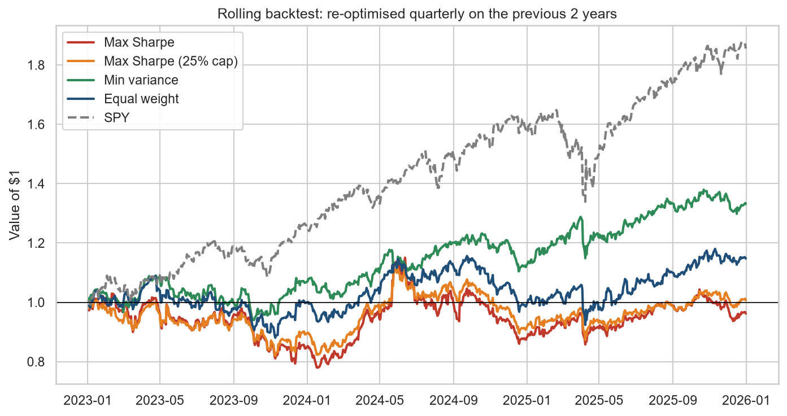
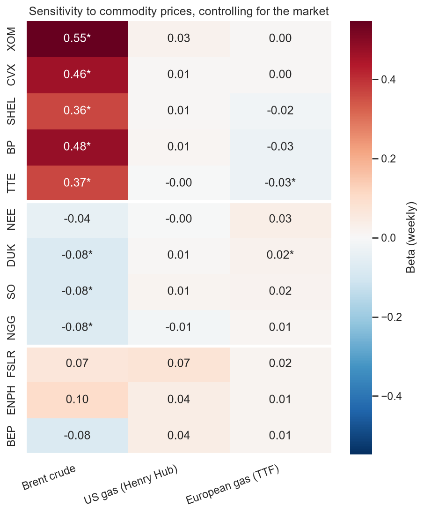

# Energy Stock Portfolio Analysis

How did oil majors, utilities and renewables compare on risk and return from 2021 to 2025, what would an optimised energy portfolio have looked like, and does that optimisation hold up on data it hasn't seen?


## Key findings

- **Oil & gas led on risk-adjusted return.** The sector averaged a Sharpe ratio of 0.59, against 0.29 for utilities and −0.16 for renewables. ExxonMobil returned 29.0% a year (Sharpe 0.92), turning $1 into $3.55 against $1.98 for the S&P 500, and was the only stock to beat SPY's Sharpe of 0.63.
- **2022 is where the sectors split.** Oil and gas stocks gained an average of 50% in 2022 while SPY fell 18%, as oil and gas prices spiked. Oil volatility peaked at about 40% in July 2022.
- **Renewables were the riskiest sector.** Their volatility stayed between 44% and 55% every year. Enphase fell 81% over the period, with a maximum drawdown of 92%.
- **Diversifying within oil does little.** The five oil majors have an average correlation of 0.75 with each other, but only 0.14 with utilities and renewables.
- **NextEra behaves like a utility but carried renewables-style risk.** Its correlation is 0.53 with other utilities, yet its drawdown reached −45%, against −23% to −39% for the other utilities.
- **The optimiser combines sectors.** The max-Sharpe portfolio holds 50% XOM, 23% Southern Company, 15% National Grid and 13% First Solar, giving a Sharpe ratio of 1.09 against 0.66 for SPY on the same basis. The minimum-variance portfolio reached 14.3% volatility, below SPY's 17.1%.

## Backtesting and commodity drivers

Does the optimiser still work on data it hasn't seen, and how much do oil and gas prices drive these stocks? See [`notebooks/02_backtest_and_commodities.ipynb`](notebooks/02_backtest_and_commodities.ipynb).



- **Re-optimised every quarter, the max-Sharpe portfolio came last.** In a walk-forward backtest from 2023 to 2025 it lost 1.3% a year while SPY gained 23.0%. It kept chasing the previous two years' winners, starting with 72% ExxonMobil just as oil's rally ended.
- **Minimum variance held up best of the strategies,** returning 10.1% a year with a −13.8% maximum drawdown, because volatility and correlations are more stable over time than returns.
- **Out of sample, optimisation beat equal weight but not the market.** Weights chosen on 2021–2023 returned 15.3% a year in 2024–2025, against 8.3% for equal weight and 21.3% for SPY.



- **Oil majors track Brent strongly.** All five have significant Brent betas (0.36 to 0.55, t-statistics 9–14), controlling for the market: a 10% weekly rise in Brent goes with a 3.6–5.5% rise in the stock.
- **Gas prices barely register once oil is accounted for.** No stock has a significant Henry Hub beta, and European (TTF) gas betas are all below 0.04 in size.
- **Oil sensitivity stayed steady through 2022.** The oil majors' rolling Brent beta stayed between 0.32 and 0.59, so their 2022 gains came from the size of the oil price rise, not from becoming more sensitive to it.
- **Renewables show no reliable link to fossil fuel prices,** and utilities lean slightly against oil (betas of about −0.08 for Duke, Southern and National Grid).

## Method

- Daily adjusted prices (dividends and splits included) for 12 US-listed energy stocks and SPY, 2021–2025, from Yahoo Finance via `yfinance`
- Annualised return, volatility, Sharpe ratio (4% risk-free rate), maximum drawdown and beta against the S&P 500
- Long-only mean-variance optimisation with SciPy (SLSQP): maximum Sharpe, minimum variance and the efficient frontier. This is the same kind of constrained optimisation used for economic dispatch in energy systems
- Out-of-sample test (optimise on 2021–2023, hold through 2024–2025) and a walk-forward backtest re-optimising each quarter on the previous two years, with buy-and-hold weight drift between rebalances
- Weekly regressions of each stock on the S&P 500, Brent crude, Henry Hub gas and Dutch TTF gas futures with statsmodels, plus rolling 52-week regressions

| Sector | Tickers |
| --- | --- |
| Oil & Gas | XOM, CVX, SHEL, BP, TTE |
| Utilities | NEE, DUK, SO, NGG |
| Renewables | FSLR, ENPH, BEP |
| Benchmark | SPY |

## Charts


## Run it yourself

```bash
git clone https://github.com/ConnorLava42/energy-portfolio-analysis.git
cd energy-portfolio-analysis
python -m venv .venv
source .venv/bin/activate        # Windows: .venv\Scripts\activate
pip install -r requirements.txt
```

Then open the notebooks in `notebooks/` and run all cells: `analysis.ipynb` first, then `02_backtest_and_commodities.ipynb`. The first run downloads price data into `data/`.

## Project structure

```
src/config.py      tickers, dates and settings
src/data.py        download and cache prices
src/metrics.py     return and risk metrics
src/plots.py       charts
src/optimise.py    portfolio optimisation
src/backtest.py    out-of-sample and walk-forward backtests
src/commodities.py commodity regressions
notebooks/         analysis.ipynb (risk, return, optimisation) and
                   02_backtest_and_commodities.ipynb
figures/           saved charts
```

## Limitations

- **Hindsight bias in the first notebook.** Its optimised weights are judged on the data they were built from. The backtests in the second notebook address this.
- **A short backtest.** Twelve quarterly rebalances is a small sample, and trading costs are not included.
- **Association, not causation.** The commodity regressions show which stocks move with oil and gas prices, not that those prices cause the moves. With 36 commodity betas tested, a few borderline results are expected by chance.
- **An unusual window.** The 2022 energy crisis flatters oil and gas.
- **Selection bias.** Stocks were chosen in 2026 from companies that still exist.
- **Volatility understates tail risk.** Mean-variance optimisation does not capture crashes like Enphase's 92% drawdown.
- **Simplified assumptions.** A fixed 4% risk-free rate, no trading costs, taxes or rebalancing, and all prices in US dollars.

*Educational analysis of historical data. Not investment advice.*
