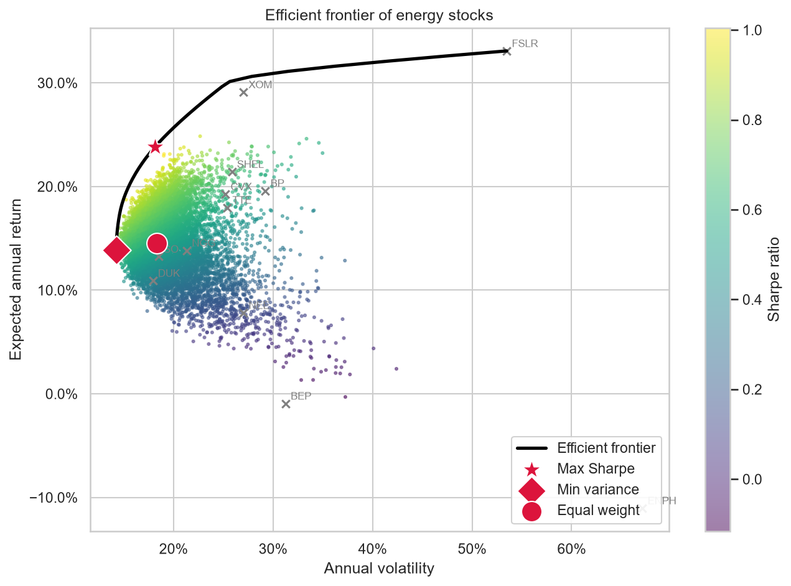
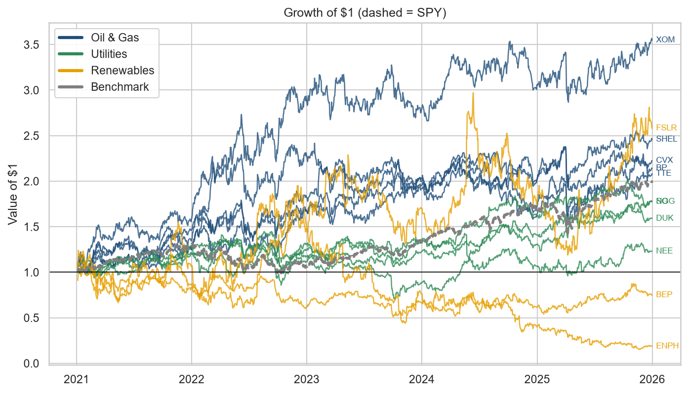
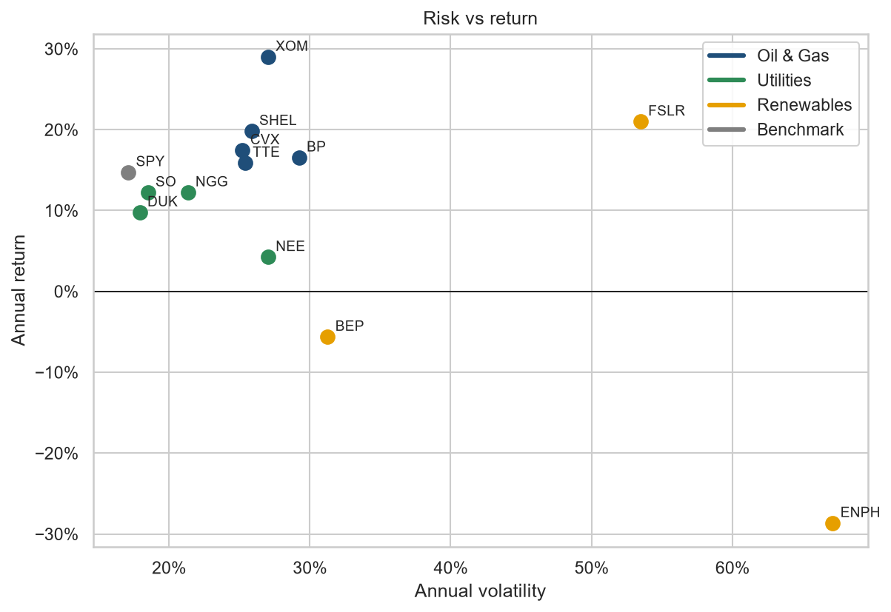
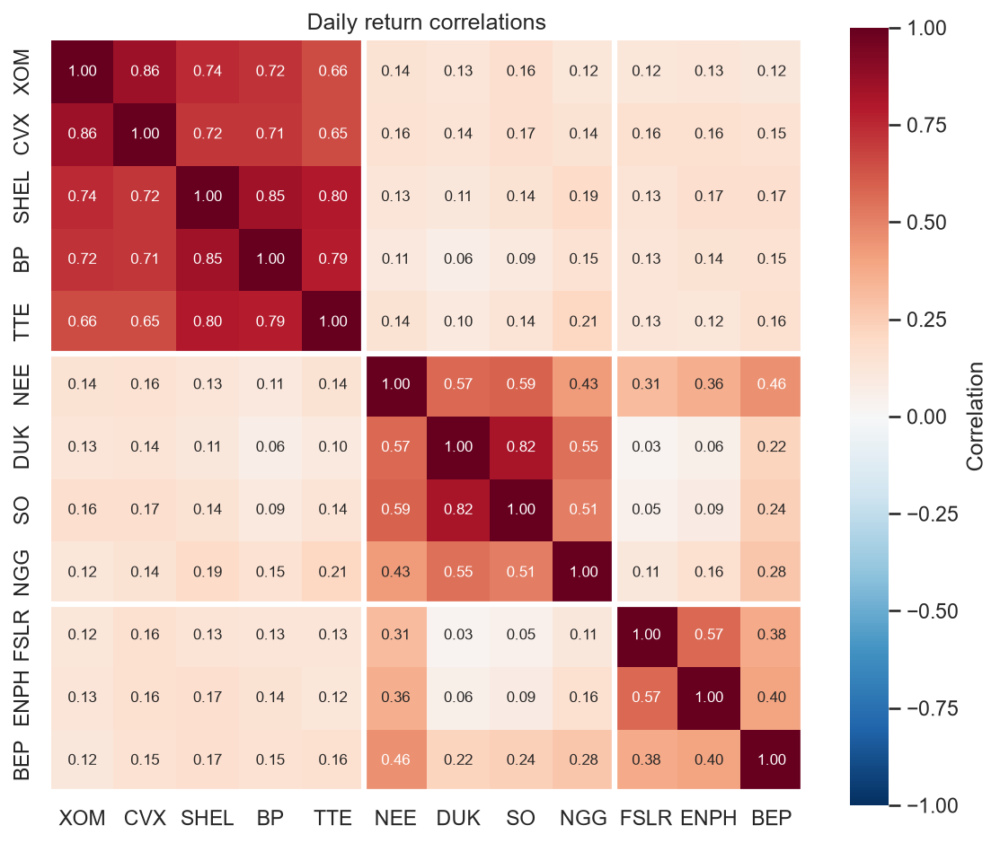
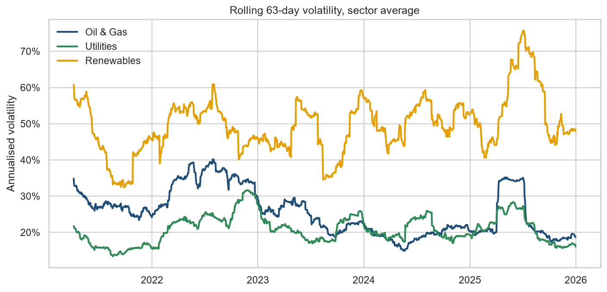

# Energy Stock Portfolio Analysis

How did oil majors, utilities and renewables compare on risk and return from 2021 to 2025, and what would an optimised energy portfolio have looked like?



## Key findings

- **Oil & gas led on risk-adjusted return.** The sector averaged a Sharpe ratio of 0.59, against 0.29 for utilities and −0.16 for renewables. ExxonMobil returned 29.0% a year (Sharpe 0.92), turning $1 into $3.55 against $1.98 for the S&P 500, and was the only stock to beat SPY's Sharpe of 0.63.
- **2022 is where the sectors split.** Oil and gas stocks gained an average of 50% in 2022 while SPY fell 18%, as oil and gas prices spiked. Oil volatility peaked at about 40% in July 2022.
- **Renewables were the riskiest sector.** Their volatility stayed between 44% and 55% every year. Enphase fell 81% over the period, with a maximum drawdown of 92%.
- **Diversifying within oil does little.** The five oil majors have an average correlation of 0.75 with each other, but only 0.14 with utilities and renewables.
- **NextEra behaves like a utility but carried renewables-style risk.** Its correlation is 0.53 with other utilities, yet its drawdown reached −45%, against −23% to −39% for the other utilities.
- **The optimiser combines sectors.** The max-Sharpe portfolio holds 50% XOM, 23% Southern Company, 15% National Grid and 13% First Solar, giving a Sharpe ratio of 1.09 against 0.66 for SPY on the same basis. The minimum-variance portfolio reached 14.3% volatility, below SPY's 17.1%.

## Method

- Daily adjusted prices (dividends and splits included) for 12 US-listed energy stocks and SPY, 2021–2025, from Yahoo Finance via `yfinance`
- Annualised return, volatility, Sharpe ratio (4% risk-free rate), maximum drawdown and beta against the S&P 500
- Long-only mean-variance optimisation with SciPy (SLSQP): maximum Sharpe, minimum variance and the efficient frontier. This is the same kind of constrained optimisation used for economic dispatch in energy systems

| Sector | Tickers |
| --- | --- |
| Oil & Gas | XOM, CVX, SHEL, BP, TTE |
| Utilities | NEE, DUK, SO, NGG |
| Renewables | FSLR, ENPH, BEP |
| Benchmark | SPY |

## Charts









## Run it yourself

```bash
git clone https://github.com/ConnorLava42/energy-portfolio-analysis.git
cd energy-portfolio-analysis
python -m venv .venv
source .venv/bin/activate        # Windows: .venv\Scripts\activate
pip install -r requirements.txt
```

Then open `notebooks/analysis.ipynb` and run all cells. The first run downloads the price data to `data/prices.csv`.

## Project structure

```
src/config.py      tickers, dates and settings
src/data.py        download and cache prices
src/metrics.py     return and risk metrics
src/plots.py       charts
src/optimise.py    portfolio optimisation
notebooks/         the full analysis, with outputs
figures/           saved charts
```

- **An unusual window.** The 2022 energy crisis flatters oil and gas.
- **Selection bias.** Stocks were chosen in 2026 from companies that still exist.
- **Volatility understates tail risk.** Mean-variance optimisation does not capture crashes like Enphase's 92% drawdown.
- **Simplified assumptions.** A fixed 4% risk-free rate, no trading costs, taxes or rebalancing, and all prices in US dollars.

*Educational analysis of historical data. Not investment advice.*
